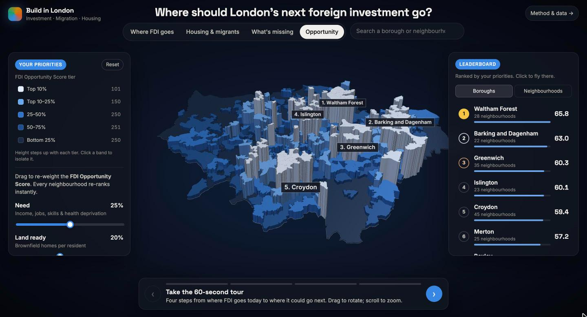
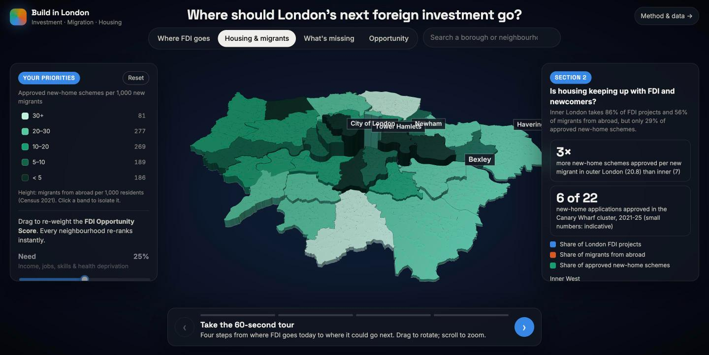

# Build in London

**Where should London's next foreign investment go?**

An interactive 3D map and analysis of how foreign direct investment (FDI), migration and housing interact across London, and which deprived neighbourhoods have the land and characteristics to take investment next.

Built at House London (Newspeak House, 7 November 2026), a one-day data sprint on London's housing crisis.

**Live app: https://build-in-london-web.vercel.app**  ·  Method & data: https://build-in-london-web.vercel.app/report



---

## The story in four steps

| | Question | Finding |
|---|---|---|
| **1. Where FDI goes** | Where does overseas investment land, compared with deprivation? | Inner West London gets **62%** of London's FDI projects but holds only **11%** of its most deprived neighbourhoods: about **27×** more projects per head than Outer East & North East. The pattern holds every year from 2023-24 to 2025-26. |
| **2. Housing & migrants** | Is housing keeping up where FDI and migrants concentrate? | Inner London takes **86%** of FDI projects and **56%** of migrants from abroad, but only **29%** of approved new-home schemes. Outer London approves about **3×** more new-home schemes per new migrant (20.8 vs 7.0 per 1,000). In the Canary Wharf cluster, 6 of 22 new-home applications were approved (2021-25). |
| **3. What's missing** | What do deprived areas lack, and what do they already have? | Deprived neighbourhoods with lower housing demand hold **3.0×** the brownfield housing capacity per resident of high-demand, better-off areas. They have land; what they lack is income, jobs, skills and health. |
| **4. Opportunity** | Where should investment go next? | An adjustable **FDI Opportunity Score** combines need, land readiness, current under-investment, room to grow, workforce and access to services. With default weights the top boroughs are Waltham Forest, Barking and Dagenham, Greenwich, Islington and Croydon. |

All findings are associations, not proof of cause.

---

## The app



- **3D London:** every neighbourhood (MSOA, about 8,000 residents) is a block. Drag to rotate, scroll to zoom, hover for details.
- **Four views,** one per step of the story, each with clearly banded colours and a clickable legend that isolates a band (for example, only the top 10%).
- **Your priorities:** six sliders re-weight the Opportunity Score, and the map and leaderboard re-rank instantly.
- **Leaderboard and search:** rank boroughs or neighbourhoods, then click to fly there and open a detail card showing how the area scores on each factor.
- **Story tour:** a four-step guided walkthrough (arrow keys work) for presenting.
- **Method & data page** (`report.html`): charts, method notes and caveats for each section.

It's a static site (HTML, CSS and JavaScript, with [deck.gl](https://deck.gl) for the 3D map and Leaflet on the report page). There's no backend and no API keys.

---

## Run it locally

```bash
cd web
python3 -m http.server 8765
# open http://localhost:8765
```

An internet connection is needed for the map library and fonts (loaded from CDNs).

### Rebuild the data

Requires [uv](https://docs.astral.sh/uv/) (`brew install uv`).

```bash
uv sync                                              # create the Python environment
uv run python -m house_london_hackathon.section3     # Section 3: deprivation + brownfield tables
uv run python scripts/export_web.py                  # write all app data to web/data/
```

Sections 1 and 2 are self-contained pipelines with their own READMEs:

```bash
cd sections/section1 && sh run_all.sh
cd sections/section2 && sh run_all.sh
```

Raw downloads for Section 3 go in `data/raw/` (git-ignored); the Section 3 scripts download them automatically on first run.

### Deploy

Deployed on [Vercel](https://vercel.com) with **Root Directory = `web`**, Framework Preset **Other** and no build settings (`web/vercel.json` enables clean URLs). Every push to `main` redeploys.

---

## Repository layout

```
web/                     the app (index.html) and method & data page (report.html)
  data/                  exported JSON/GeoJSON used by the app
scripts/export_web.py    builds web/data from all sections
sections/section1/       Section 1 pipeline: FDI vs deprivation (raw → clean → export)
sections/section2/       Section 2 pipeline: migrants vs approved new-home schemes
src/house_london_hackathon/
  section3.py            deprivation + brownfield joined to LSOA / MSOA / borough
  classify.py            four-group classification (housing demand × deprivation)
  plots.py               static figures for slides
data/processed/          Section 3 output tables (CSV + Parquet)
outputs/                 static charts (PNG)
docs/                    screenshots
```

---

## Method

**Geography.** Everything joins on official ONS codes, never on place names: boroughs (`lad24cd`), London's five ITL2 sub-areas (`itl2_cd`), and 2021 neighbourhoods (LSOA `lsoa21cd` and MSOA `msoa21cd`).

**Section 1: FDI vs deprivation.** DBT publishes FDI projects and jobs only for London's five ITL2 sub-areas, so each borough carries its sub-area's figures. "Most deprived 20%" ranks London's 4,994 LSOAs against each other (IMD 2025). Suppressed DBT values are left blank, never zero. 2024-25 is the only year all five sub-areas are published.

**Section 2: housing & migrants.** Migrants come from Census 2021 MIG001 (address one year before the census). New migrants are those from abroad plus the rest of the UK. New-home schemes (9,089) are identified from planning application descriptions (new build, conversion or change of use creating homes), excluding follow-up applications and householder extensions. Rates use decided applications only. The analysis counts schemes, not homes.

**Section 3: what's missing.**
- **Deprivation:** population-weighted IoD 2025 scores for income, employment, education and health, combined with the official IMD weights.
- **Unmet housing demand:** the IoD 2025 wider-barriers sub-domain (overcrowding, homelessness, affordability).
- **Groups:** a median split on each axis within London gives four groups:
  - A: high demand, deprived
  - B: high demand, not deprived
  - C: low demand, deprived
  - D: low demand, not deprived
- **Brownfield:** active brownfield register sites are located to LSOAs by spatial join.

**Section 4: Opportunity Score.** Each factor is converted to a London-wide percentile, so 100 is best:

| Factor | Measure | Default weight |
|---|---|---|
| Need | People deprivation | 25 |
| Land ready | Brownfield homes per resident | 20 |
| Under-invested today | Low FDI per head in the area's sub-area | 20 |
| Room to grow | Lower housing demand | 15 |
| Workforce | Working-age share | 10 |
| Access to services | Shorter distances to services | 10 |

The score is the weighted average of these percentiles. Boroughs are ranked by the population-weighted mean of their neighbourhoods' scores.

### Caveats

- **Association, not causation.**
- **FDI is sub-area level only.** Borough and neighbourhood FDI values inherit their sub-area's figure.
- **Housing demand is correlated with deprivation** (r ≈ 0.7), so groups B and C are smaller than A and D.
- **Brownfield homes are lower bounds.** About 32% of sites have no dwelling estimate, including every site in Tower Hamlets and Enfield. Sites over 100 ha are treated as data-entry errors.
- **Section 2 counts planning schemes, not homes.** Migration is from the 2021 Census, taken during COVID-19 restrictions.
- **Housing-type flags come from wording.** Mentions such as "affordable" in planning descriptions are not official tenure data.

---

## Data sources

| Dataset | Publisher | Used for |
|---|---|---|
| [Inward Investment Results 2025-26](https://www.gov.uk/government/statistics/dbt-inward-investment-results-2025-to-2026) (Tables 4.1, 4.12) | Department for Business and Trade | FDI projects and jobs by London sub-area |
| [English Indices of Deprivation 2025](https://www.gov.uk/government/statistics/english-indices-of-deprivation-2025) (Files 1, 7 and 8, plus local authority summaries) | MHCLG | Deprivation domains, unmet housing demand, age structure |
| Census 2021 MIG001 (migrant inflow by local authority) | ONS | Migrants from abroad and the rest of the UK |
| London planning applications 2015-2025 | London planning authority portals | New-home schemes and approvals |
| [Brownfield land registers](https://www.planning.data.gov.uk/dataset/brownfield-land) | MHCLG (planning.data.gov.uk) | Brownfield sites and potential homes |
| LSOA/MSOA boundaries and lookups (Dec 2021), Local Authority Districts (Dec 2024) | ONS Open Geography Portal | Maps and joins |

Detailed source notes: [`sections/section1/export/SOURCES.md`](sections/section1/export/SOURCES.md) and [`sections/section2/export/SOURCES.md`](sections/section2/export/SOURCES.md).

ONS, DBT and MHCLG data are used under the [Open Government Licence v3.0](https://www.nationalarchives.gov.uk/doc/open-government-licence/version/3/). Boundaries contain National Statistics and OS data © Crown copyright and database right.
